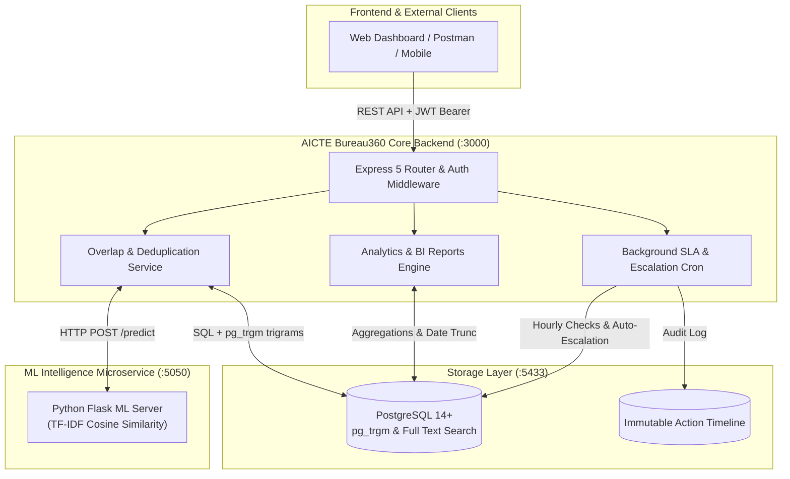
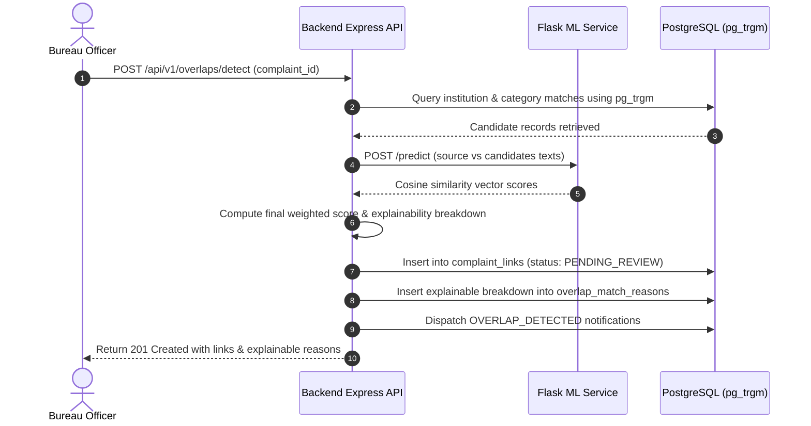
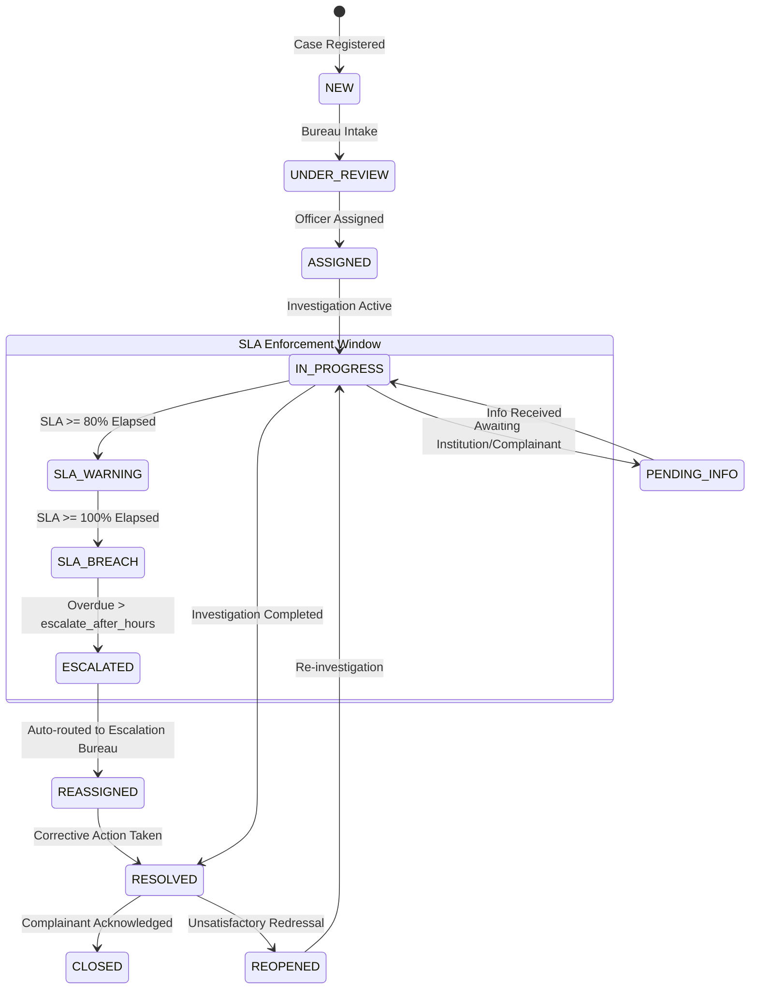

# AICTE Bureau360 — Integrated Complaint Tracking & Institution Monitoring Dashboard

[](https://www.docker.com/)
[](https://nodejs.org/)
[](https://expressjs.com/)
[](https://www.postgresql.org/)
[](https://python.org/)
[](https://www.sih.gov.in/)

<p align="center">
  <a href="https://aicte-bureau360.vercel.app/" target="_blank">
    
  </a>
</p>

> **Smart India Hackathon 2026 — Problem Statement 26264**  
> AICTE Bureau360 is an enterprise-grade grievance redressal, multi-bureau workflow management, overlap intelligence, and institutional monitoring system engineered for the All India Council for Technical Education (AICTE).

---

## 📑 Table of Contents

1. [System Overview & Architecture](#-system-overview--architecture)
2. [Member 2 Responsibilities — Intelligence & Analytics](#-member-2-responsibilities--intelligence--analytics)
3. [Dynamic Overlap Detection Engine](#-dynamic-overlap-detection-engine)
4. [SLA Monitoring & Auto-Escalation State Machine](#-sla-monitoring--auto-escalation-state-machine)
5. [Analytics & Reporting Calculations](#-analytics--reporting-calculations)
6. [Live API Reference & Payloads](#-live-api-reference--payloads)
7. [Automated Verification & Testing](#-automated-verification--testing)
8. [Setup, Docker & Deployment](#-setup-docker--deployment)
9. [Git Workflow for `overlap-detection`](#-git-workflow-for-overlap-detection)

---

## 🏛️ System Overview & Architecture

AICTE Bureau360 operates as a containerized microservices architecture composed of a **Node.js/Express Core API Gateway**, a **Python Flask ML Microservice** for natural language semantic similarity, and a **PostgreSQL 14+ database** equipped with the `pg_trgm` extension for high-performance fuzzy trigram string matching.



---

## 🎯 Member 2 Responsibilities — Intelligence & Analytics

Member 2 owns the **Intelligence, Deadline Rules, and Reporting Calculations** across AICTE Bureau360:

1. **Exact Institution ID Matching & Normalized-Name Matching** — AICTE permanent institution code cross-referencing and fuzzy institutional name normalization via trigram indexes.
2. **Complaint Category & Description Similarity** — Dynamic textual similarity combining string metrics with machine learning TF-IDF cosine vector matching.
3. **Explainable Overlap Scores & Alerts** — Computed similarity scores (0.000 to 1.000) decomposed into auditable reasons (`overlap_match_reasons`) with instant officer notifications.
4. **Related-Case Linking & Review Decisions** — Overlap triage workflows (`CONFIRMED` as `DUPLICATE` or `RELATED_CASE`, or `DISMISSED` with automated flag cleanup).
5. **Pending Reminders, SLA Monitoring & Escalation Logic** — Multi-stage deadline tracking (Warning at 80% SLA $\rightarrow$ Breach at 100% $\rightarrow$ Auto-escalation with bureau reassignment and audit logging).
6. **Case Ageing Analysis & Disposal-Rate Calculations** — Multi-bucket ageing analysis ($0-7$, $8-15$, $16-30$, $>30$ days) and dynamic resolution compliance formulas.
7. **Bureau-Wise, Region-Wise & Institution-Wise Report APIs** — Comprehensive cross-sectional breakdown endpoints for national and regional oversight.
8. **Monthly / Quarterly Analytics & Overlap Reports** — Historical timeline trends and deduplication intelligence analytics.
9. **Tests for False Positives & Missed Matches** — Automated verification suite preventing duplicate noise while catching nuanced repeats.

---

## 🔍 Dynamic Overlap Detection Engine

### 1. Hybrid Overlap Scoring Formula

When a complaint is analyzed against existing active grievances, the engine computes a composite confidence score:

$$\text{Overlap Score} = w_1 \cdot S_{\text{inst}} + w_2 \cdot S_{\text{cat}} + w_3 \cdot S_{\text{text}}$$

- **$S_{\text{inst}}$ (Institution Weight = 0.40):**
  - **1.0** if Permanent AICTE ID matches exactly.
  - **Trigram similarity score ($\ge 0.5$)** if institution names are variations (e.g., *"COEP Pune"* vs *"College of Engineering Pune"*).
- **$S_{\text{cat}}$ (Category Weight = 0.25):**
  - **1.0** if complaint categories are identical (e.g., both `RAGGING` or `FACULTY_IRREGULARITY`).
- **$S_{\text{text}}$ (Description Similarity Weight = 0.35):**
  - Computed via Python Flask ML microservice using TF-IDF vectorization and cosine similarity over complaint descriptions.

If $\text{Overlap Score} \ge 0.40$ (configurable threshold), a candidate link is generated, recorded with explainable reasons, and flagged for officer review.



---

## ⏱️ SLA Monitoring & Auto-Escalation State Machine

Every complaint registered with AICTE Bureau360 has strict legal SLAs configured by bureau and category (e.g., `EMERGENCY` = 24h, `RAGGING` = 48h, `STANDARD` = 360h).



### Dynamic Auto-Escalation Worker (`src/jobs/slaReminder.js`)
Runs as an automated background cron worker:
1. **Warning Check:** Identifies cases nearing 80% SLA threshold and dispatches `SLA_WARNING` notifications to the current assignee.
2. **Breach Check:** Identifies cases reaching 100% SLA limit, tags overdue status, and dispatches `SLA_BREACH` alerts.
3. **Auto-Escalation Transition:** For cases exceeding `escalate_after_hours`:
   - Updates status to `ESCALATED`.
   - Reassigns complaint to the Bureau's designated escalation bureau (e.g., Central Vigilance Cell).
   - Inactivates previous officer assignment (`is_current = false`).
   - Inserts immutable timeline action (`ESCALATED_AUTO`).

---

## 📊 Analytics & Reporting Calculations

### Key Metrics & Formulas

- **Disposal Rate (%):**
  $$\text{Disposal Rate} = \left(\frac{N_{\text{Resolved}} + N_{\text{Closed}}}{N_{\text{Total}}}\right) \times 100$$
- **SLA Compliance Rate (%):**
  $$\text{SLA Compliance} = \left(\frac{N_{\text{Resolved on or before target date}}}{N_{\text{Total Resolved}}}\right) \times 100$$
- **Ageing Buckets:**
  - `0 - 7 days`: Fresh grievances
  - `8 - 15 days`: Actively investigated cases
  - `16 - 30 days`: High-priority pending cases
  - `> 30 days`: Critical aged backlog

---

## 🔌 Live API Reference & Payloads

### 1. Authentication
All protected routes require a Bearer JWT token obtained via `/login`.

```http
POST /api/v1/auth/login
Content-Type: application/json

{
  "email": "admin@aicte.gov.in",
  "password": "Admin@123"
}
```

---

### 2. Overlap Detection & Review

#### Run Overlap Detection for a Complaint
```http
POST /api/v1/overlaps/detect
Authorization: Bearer <TOKEN>
Content-Type: application/json

{
  "complaint_id": "c1000000-0000-0000-0000-000000000001"
}
```
**Response (201 Created):**
```json
{
  "data": {
    "detected_links": 1,
    "links": [
      {
        "id": "e3000000-0000-0000-0000-000000000001",
        "complaint_id": "c1000000-0000-0000-0000-000000000001",
        "related_complaint_id": "c1000000-0000-0000-0000-000000000002",
        "similarity_score": 0.875,
        "link_type": "DUPLICATE",
        "review_status": "PENDING_REVIEW",
        "reasons": [
          { "matching_method": "EXACT_INSTITUTION_ID", "score_contribution": 0.40 },
          { "matching_method": "CATEGORY_MATCH", "score_contribution": 0.25 },
          { "matching_method": "DESCRIPTION_SIMILARITY", "score_contribution": 0.225 }
        ]
      }
    ]
  }
}
```

#### Submit Review Decision
```http
PATCH /api/v1/overlaps/e3000000-0000-0000-0000-000000000001/review
Authorization: Bearer <TOKEN>
Content-Type: application/json

{
  "review_status": "CONFIRMED",
  "link_type": "DUPLICATE",
  "review_notes": "Identical grievance submitted by student association."
}
```

---

### 3. Analytics & BI Reports

| Endpoint | Description | Query Parameters |
| :--- | :--- | :--- |
| `GET /api/v1/reports/bureaus` | Bureau-wise caseload, disposal rate, avg resolution hours | `from`, `to`, `bureau_id` |
| `GET /api/v1/reports/regions` | Region-wise distribution across all AICTE zones | `from`, `to` |
| `GET /api/v1/reports/hotspots` | Institution hotspot ranking by complaint volume & repeat offenses | `limit`, `min_complaints` |
| `GET /api/v1/reports/trend` | Time-series monthly or quarterly case influx vs disposal | `period=month` or `period=quarter` |
| `GET /api/v1/reports/overlaps` | Overlap intelligence report: links by status, type & method | `from`, `to` |

#### Sample: Quarterly Analytics Trend (`GET /api/v1/reports/trend?period=quarter`)
```json
{
  "data": [
    {
      "period": "2026-Q4",
      "total_registered": 14,
      "resolved": 6,
      "disposal_rate": 42.86,
      "with_overlap": 5
    }
  ]
}
```

---

## 🧪 Automated Verification & Testing

### 1. Instant PowerShell E2E Test Script
We provide a turnkey automated test script that exercises all 9 Member 2 responsibilities against the live running stack:

```powershell
cd AICTE_Bureau360-backend
.\test-member2.ps1
```

**What the test verifies:**
- [x] Admin authentication & JWT token issuance
- [x] Dynamic Overlap detection across exact IDs and normalized institution names
- [x] Explainable score breakdown in `overlap_match_reasons`
- [x] Review decisions (`CONFIRMED` $\rightarrow$ `DISMISSED` flag lifecycle)
- [x] Bureau-wise, Region-wise, and Institution-hotspot report APIs
- [x] Quarterly trend calculations (`?period=quarter`)
- [x] Overlap intelligence summary reports
- [x] Notification dispatch and unread badge count
- [x] False positive discrimination (unrelated complaint verification)

### 2. Automated Vitest Suite
```bash
docker exec aicte_bureau360-backend-api-1 npm test tests/overlap_analytics.test.js
```

---

## 🚀 Setup, Docker & Deployment

### Run Complete Stack with Docker Compose
```bash
cd AICTE_Bureau360-backend

# 1. Start all 3 microservices (API + DB + ML)
docker compose up -d --build

# 2. Seed administrative account
docker exec aicte_bureau360-backend-api-1 node db/seeds/seed-admin.js
```

**Running Service Endpoints:**
- **Core Express API:** `http://localhost:3000`
- **Interactive Swagger Docs:** `http://localhost:3000/api/docs`
- **PostgreSQL Database:** `localhost:5433` (Database: `bureau360`)
- **Python Flask ML Microservice:** `http://localhost:5050/health`

---

## 🌿 Git Workflow for `overlap-detection`

Member 2 changes are maintained in the dedicated `overlap-detection` branch.

### Pushing Updates
```powershell
# 1. Go to repository root
cd "c:\Users\SNEHA\OneDrive\Desktop\SIH2664\AICTE_Bureau360"

# 2. Confirm branch
git checkout overlap-detection

# 3. Stage & Commit
git add .
git commit -m "feat(member-2): update overlap intelligence and reports"

# 4. Push to GitHub
git push origin overlap-detection
```

---

## 👥 Authors & Acknowledgments

- **AICTE SIH 2026 Team**
- **Member 2 Focus:** Overlap Detection, Explainability, Alerts, SLA Monitoring, and Intelligence Analytics
